# Optimal Project Team Formation System

[](https://github.com/morozzz7/System-for-establishing-and-configuring-a-project-team/actions/workflows/ci.yml)
[](https://github.com/morozzz7/System-for-establishing-and-configuring-a-project-team/actions/workflows/deploy.yml)

Decision-support system for resource managers. It turns a technical brief into structured
requirements, finds feasible project-team variants against employee competencies and availability,
and explains the trade-offs. **The system proposes; a human makes the final decision.**

The repository is privacy-safe by design: fixtures and examples use synthetic data and pseudonymous
IDs (`emp_*`, `prj_*`, `brf_*`). Cost is represented by grade coefficients, never personal salaries.

## Stack at a glance

Click any tile to jump to the relevant workflow, source area or runtime component.

| [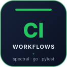](.github/workflows/ci.yml) | [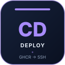](.github/workflows/deploy.yml) | [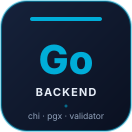](backend) | [](ml) |
|:---:|:---:|:---:|:---:|
| **CI checks** | **Deployment** | **Go backend** | **ML service** |
| [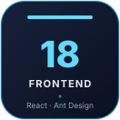](frontend) | [](db/migrations) | [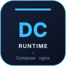](deploy) | [](frontend/e2e) |
| **React UI** | **PostgreSQL** | **Docker runtime** | **E2E journey** |

## Architecture

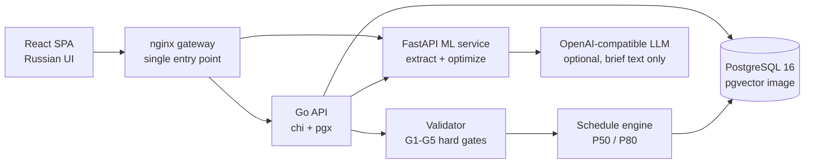

The gateway routes `/` to the SPA, `/api/` to Go and `/ml/` to the ML service. The LLM structures
brief text; it never decides assignments. Go independently re-checks every hard constraint and
recomputes duration, deficits and metrics (**"solver proposes, Go verifies"**).

<details>
<summary>Walk the architecture</summary>

1. [`frontend/`](frontend) — React 18 + TypeScript + Ant Design; deterministic mocks by default.
2. [`deploy/nginx/nginx.conf`](deploy/nginx/nginx.conf) — reverse proxy and single public port.
3. [`backend/`](backend) — API, domain, repositories, validator, schedule engine, explainer, metrics.
4. [`ml/`](ml) — FastAPI extraction, deterministic embeddings and OR-Tools CP-SAT optimizer.
5. [`db/migrations/`](db/migrations) — 30 tables, applied by the `seed` binary via Goose.

</details>

## Processing pipeline

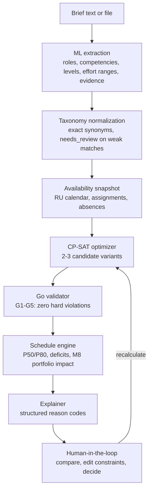

Effort is always a min/likely/max range with assumptions; duration comes from fixed-seed Monte Carlo
over that range ([`docs/METRICS.md`](docs/METRICS.md)). A year without a versioned Russian
production calendar is a G5 hard failure — never an implicit five-day week.

<details>
<summary>Where each step lives</summary>

- Extraction contract: [`contracts/ml-openapi.yaml`](contracts/ml-openapi.yaml); implementation: [`ml/app/extract`](ml/app/extract).
- UI-to-Go contract: [`contracts/openapi.yaml`](contracts/openapi.yaml).
- Capacity and candidate pool: [`backend/internal/service/candidates.go`](backend/internal/service/candidates.go).
- Validator and schedule: [`backend/internal/validator`](backend/internal/validator), [`backend/internal/schedule`](backend/internal/schedule).
- Explanations and reason codes: [`backend/internal/explain`](backend/internal/explain).
- Decision audit trail: [`backend/internal/repository`](backend/internal/repository).

</details>

## CI/CD

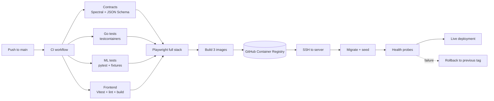

Deployment is gated on a green CI (`workflow_run`). Images are built once and pulled by the server;
secrets are written to `.env` on the server and never baked into images. Server preparation,
repository variables/secrets, manual deploy and rollback are documented in
[`docs/DEPLOYMENT.md`](docs/DEPLOYMENT.md).

<details>
<summary>Workflows and deployment assets</summary>

- [`ci.yml`](.github/workflows/ci.yml) — contracts, backend, ML, frontend, Playwright E2E.
- [`deploy.yml`](.github/workflows/deploy.yml) — GHCR build/push, SSH deploy, smoke test, rollback.
- [`deploy/prod/docker-compose.yml`](deploy/prod/docker-compose.yml) — published images, gateway-only host port.
- [`docs/DEPLOYMENT.md`](docs/DEPLOYMENT.md) — server checklist and operational commands.

</details>

> GitHub disables Mermaid `click` handlers in rendered Markdown for security. Expand the sections
> above and use the links to explore the corresponding code and documents.

## Screenshots

Captured from the running stack (`http://localhost:9080`) with synthetic demo data only; all labels
are in Russian because that is the product UI language.

| [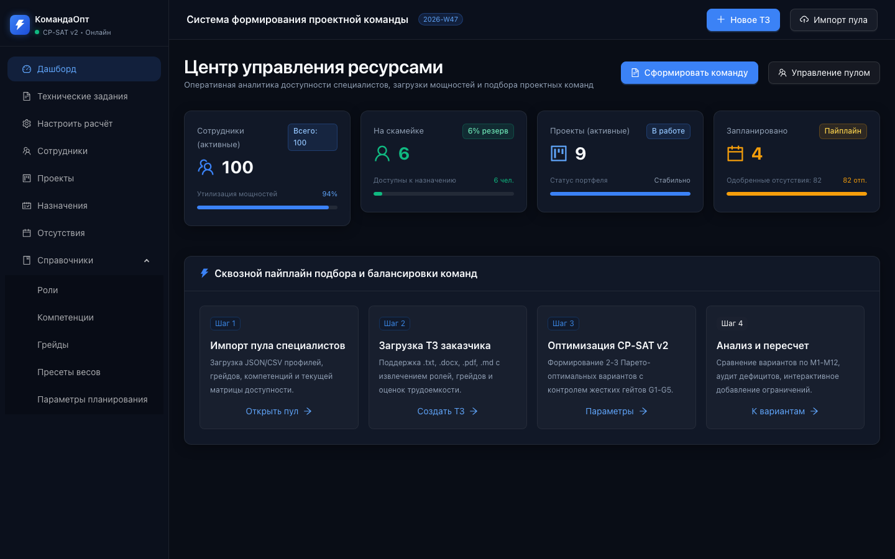](docs/screenshots/01-dashboard.png) | [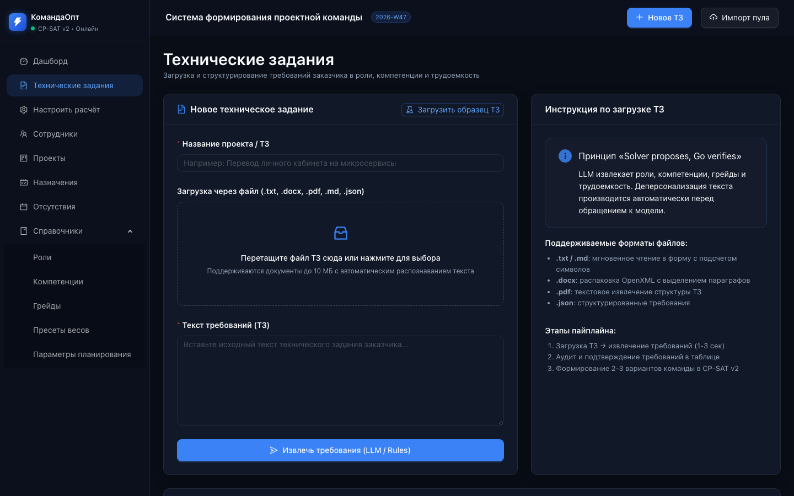](docs/screenshots/02-briefs.png) |
|:---:|:---:|
| **Resource dashboard** — availability, utilisation, portfolio and the guided pipeline | **Brief intake** — text or file upload with extraction instructions |

| [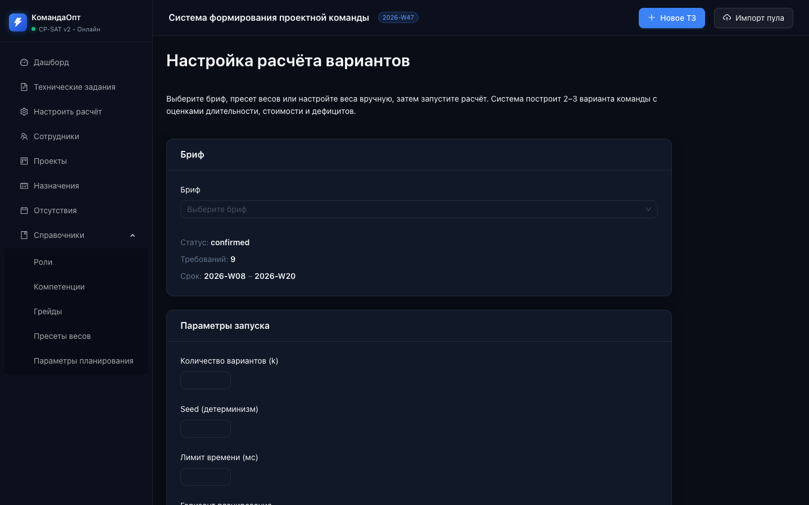](docs/screenshots/03-run-config.png) | [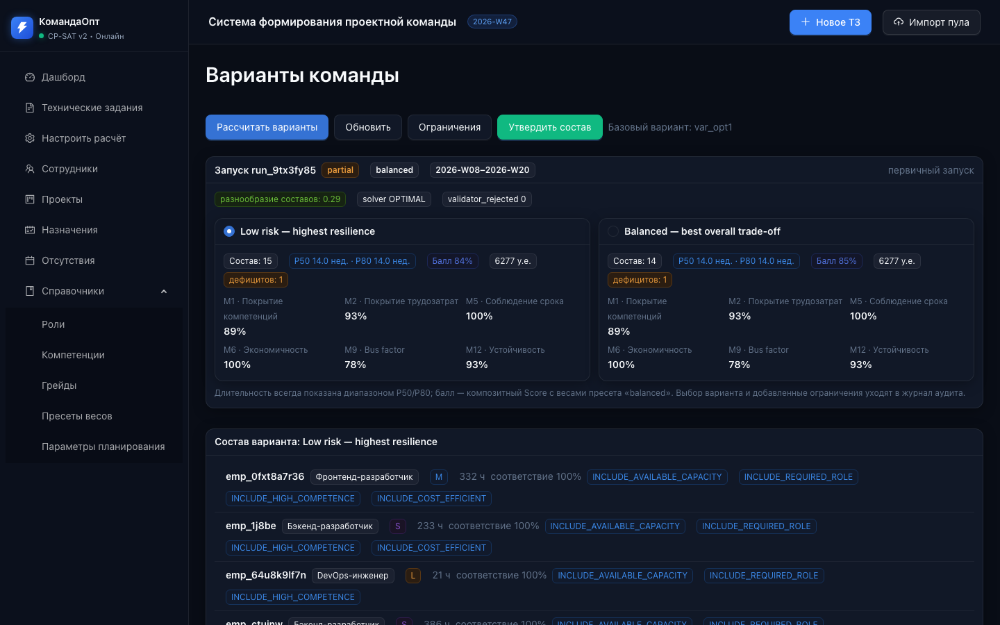](docs/screenshots/04-variants.png) |
|:---:|:---:|
| **Run configuration** — horizon, weight presets and constraints | **Variant comparison** — P50/P80, M1-M12 score, roster and reason codes |

| [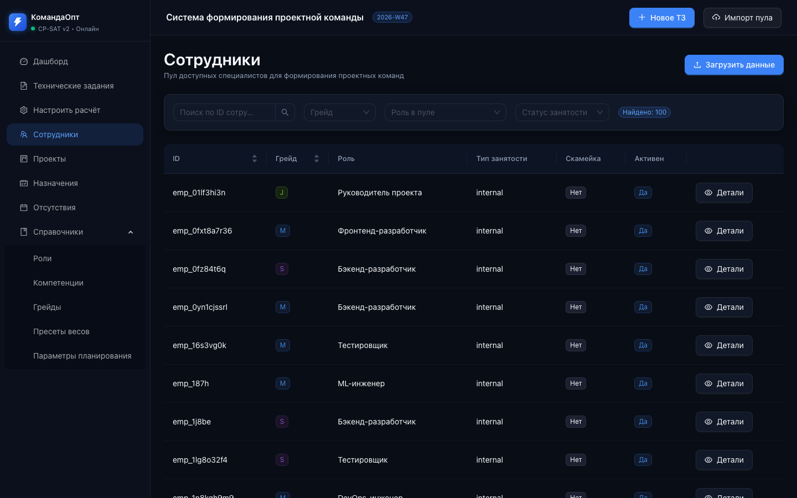](docs/screenshots/05-employees.png) | [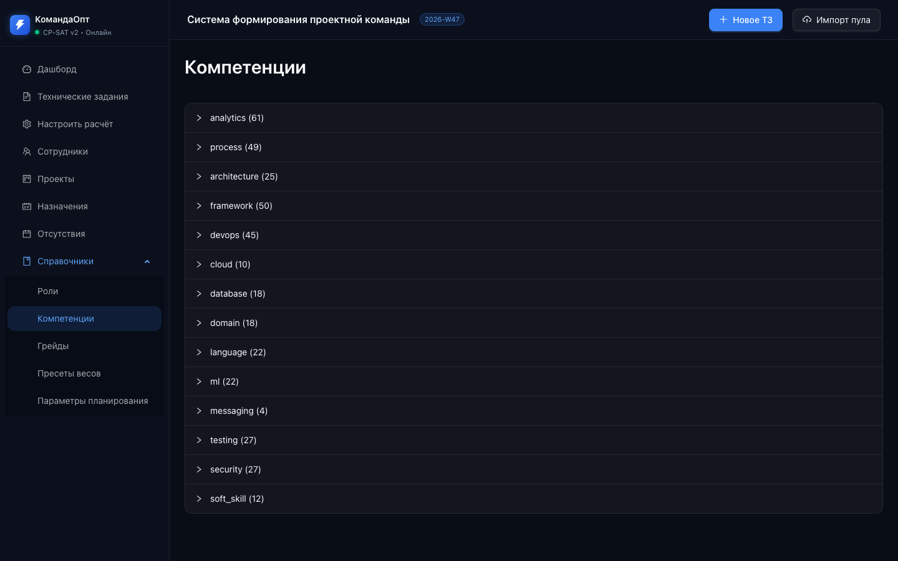](docs/screenshots/06-reference.png) |
|:---:|:---:|
| **Employee pool** — profiles, competencies and assignment load | **Competency reference** — 390 taxonomy entries by family |

## Quick start with Docker

```bash
cp .env.example .env          # keep real secrets out of git
make up                       # build, migrate, seed and wait for health
make status
```

Default host endpoints (standard ports, clean host):

| Service | URL |
| --- | --- |
| Gateway / UI | [http://localhost/](http://localhost/) |
| Backend API | [http://localhost:8080/api/v1/](http://localhost:8080/api/v1/) |
| ML service | [http://localhost:8000/](http://localhost:8000/) |
| PostgreSQL | `localhost:5432` (user: `teamopt`, db: `teamopt`) |

**The main entry point is the gateway at `http://localhost/`**: `/` → SPA, `/api/` → Go API,
`/ml/` → ML service. If standard ports are occupied, set conflict-free ports in `.env`
(`BACKEND_PORT=18080`, `ML_PORT=18000`, `FRONTEND_PORT=13000`, `POSTGRES_PORT=15432`,
`GATEWAY_PORT=9080`) and open `http://localhost:9080/`. Container ports never change:
backend 8080, ML 8000, frontend 3000, PostgreSQL 5432.

```bash
make logs       # follow all service logs
make seed       # rerun migrations/reference seed against the running DB
make down       # stop services and remove the local Compose database volume
```

`make down` uses `docker compose down -v` and is intentionally destructive for local database state.

## Local development

Backend:

```bash
cd backend && go test ./... && go build ./...
```

ML service:

```bash
cd ml
python3 -m venv .venv && . .venv/bin/activate
python -m pip install -r requirements.txt
python -m pytest tests/ -q
uvicorn app.main:app --reload --port 8000
```

Frontend:

```bash
cd frontend
npm ci
npm run dev
npm test -- --run
npm run build
```

The frontend uses deterministic mocks by default. Set `VITE_API_BASE_URL=http://localhost:8080/api/v1`
before starting Vite to use the backend brief/review/run flow.

## Verification

From the repository root:

```bash
make lint-contracts                    # Spectral + JSON Schema
make test                              # fixtures + Go tests + pytest
cd frontend && npm test -- --run && npm run lint && npm run build
make test-e2e                          # full Docker stack + Playwright journey
make test-e2e-down
```

The same gates run in GitHub Actions. Contract documents are the single source of truth: update
[`contracts/`](contracts/) before changing a cross-service API; generated code must not be hand-edited.

## Repository map

```text
backend/       Go API, domain, repositories, validator, schedule engine, explainer, metrics
ml/            FastAPI extraction, embeddings and optimizer
frontend/      React/TypeScript UI and Playwright journey
contracts/     OpenAPI, ML OpenAPI, JSON Schema, taxonomy and reference data
db/            PostgreSQL migrations and seed support
eval/          gold briefs, synthetic scenarios and benchmarks
docs/          PLAN.md, METRICS.md, DEPLOYMENT.md, ADR/, screenshots/, assets/badges/
deploy/        Dockerfiles, dev Compose, production Compose and nginx gateway
.github/       CI and CD workflows
```

## Implementation status

Delivered: resource model and capacity services, brief extraction with evidence and effort ranges,
deterministic normalization baseline, CP-SAT optimizer v2, Go validator G1-G5, the brief/review/run
vertical slice with database persistence and audit trail, Russian UI screens, the schedule engine,
full-stack E2E, CI and GHCR/SSH continuous delivery.

Planned, not claimed as implemented: sqlc/oapi-codegen generation, spaCy/Transformers pipelines,
pgvector ranking and Apache ECharts. See [`docs/PLAN.md`](docs/PLAN.md) for authoritative task status
and [`docs/METRICS.md`](docs/METRICS.md) for metric definitions.
