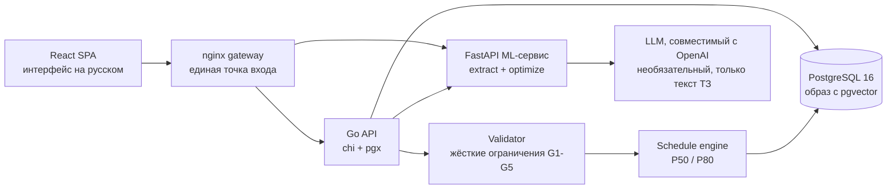
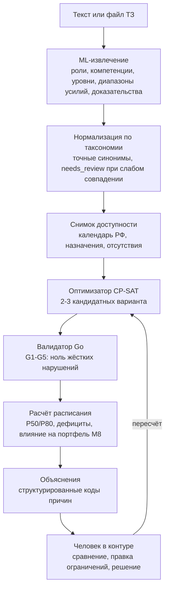
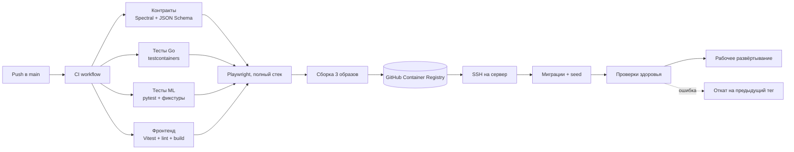
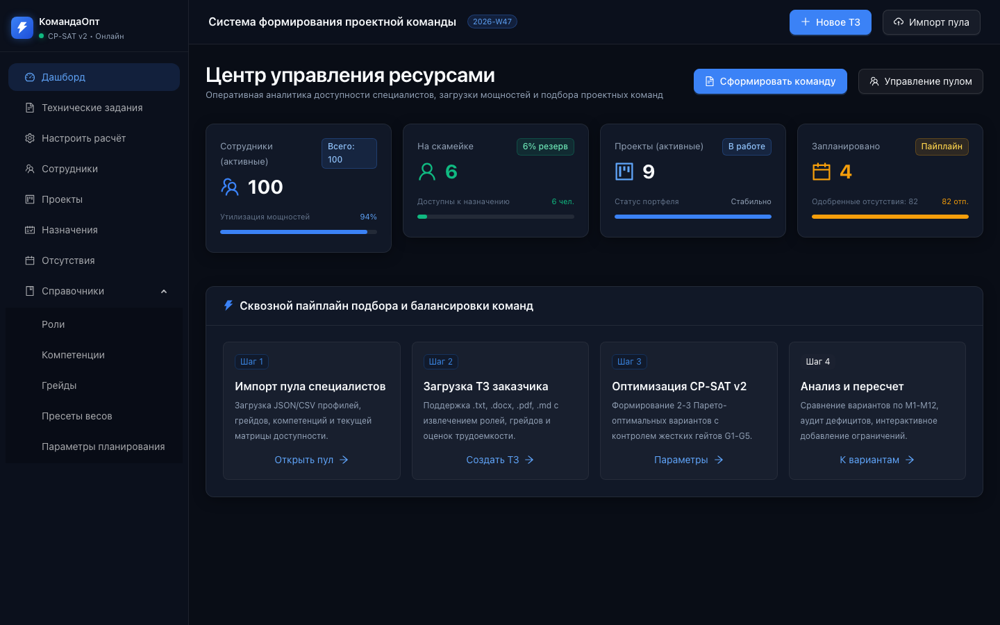
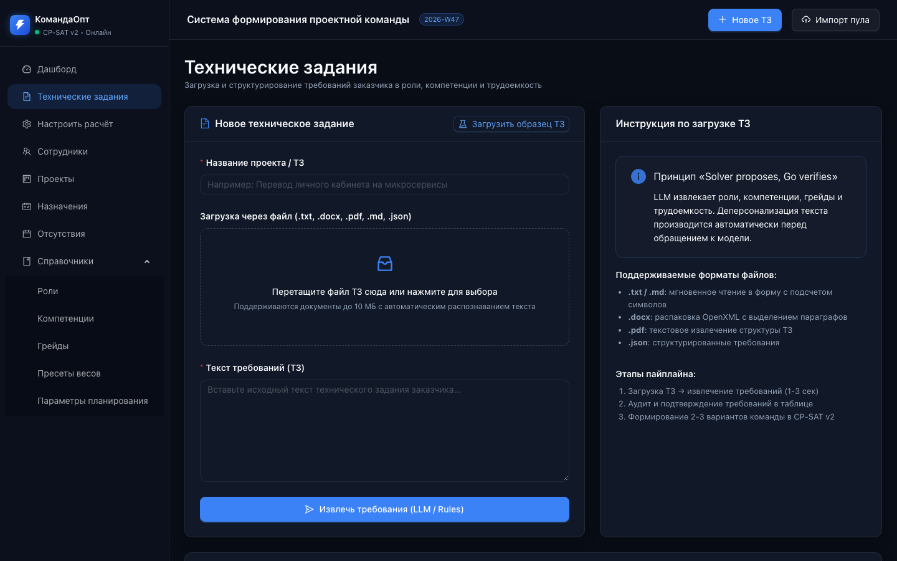
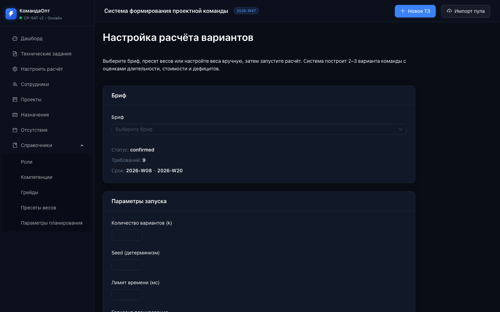
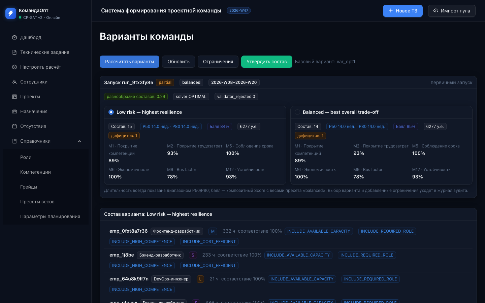
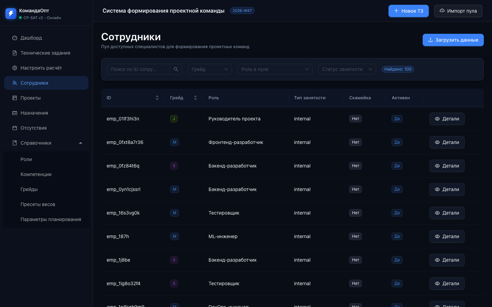
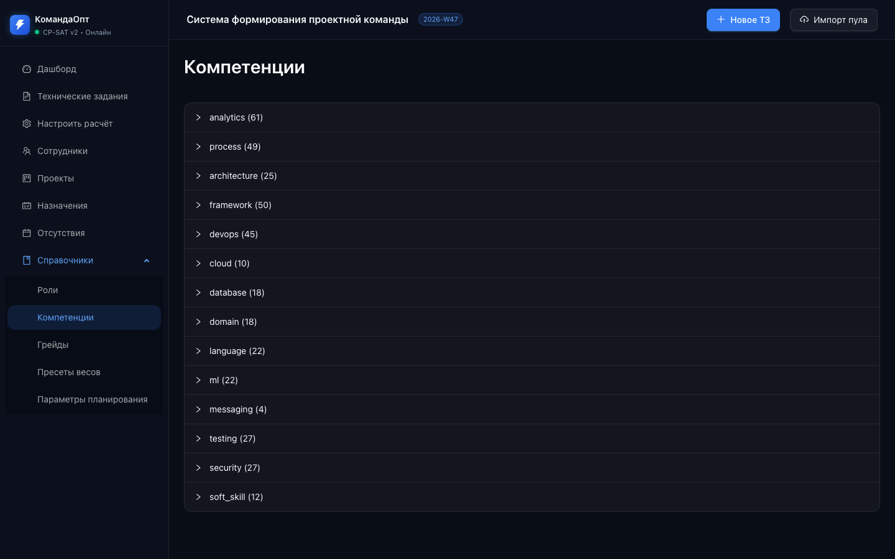

# Система формирования оптимальной проектной команды


[English](README.md) · **Русский**

Система поддержки принятия решений для руководителей проектов. Она превращает техническое задание
в структурированные требования, подбирает жизнеспособные варианты проектной команды по компетенциям
и доступности сотрудников и объясняет компромиссы между ними. **Система предлагает;
окончательное решение принимает человек.**

Репозиторий изначально безопасен с точки зрения конфиденциальности: фикстуры и примеры содержат
только синтетические данные и псевдонимы (`emp_*`, `prj_*`, `brf_*`). Стоимость выражается
коэффициентами грейдов, а не зарплатами сотрудников.

## Архитектура



Шлюз маршрутизирует `/` в SPA, `/api/` в Go и `/ml/` в ML-сервис. LLM структурирует текст задания,
но никогда не принимает решений о назначениях. Go независимо перепроверяет каждое жёсткое
ограничение и пересчитывает длительность, дефициты и метрики
(**«решатель предлагает, Go проверяет»**).

<details>
<summary>Разбор архитектуры по шагам</summary>

1. [`frontend/`](frontend) — React 18 + TypeScript + Ant Design; по умолчанию детерминированные моки.
2. [`deploy/nginx/nginx.conf`](deploy/nginx/nginx.conf) — обратный прокси и один публичный порт.
3. [`backend/`](backend) — API, домен, репозитории, валидатор, расчёт расписания, объяснения, метрики.
4. [`ml/`](ml) — FastAPI: извлечение требований, детерминированные эмбеддинги, оптимизатор OR-Tools CP-SAT.
5. [`db/migrations/`](db/migrations) — 30 таблиц, применяются бинарником `seed` через Goose.

</details>

## Конвейер обработки



Усилия всегда задаются диапазоном min/likely/max с допущениями; длительность получается методом
Монте-Карло с фиксированным seed по этому диапазону ([`docs/METRICS.md`](docs/METRICS.md)). Год без
версионированного производственного календаря РФ — жёсткая ошибка G5, а не неявная пятидневная неделя.

<details>
<summary>Где находится каждый шаг</summary>

- Контракт извлечения: [`contracts/ml-openapi.yaml`](contracts/ml-openapi.yaml); реализация: [`ml/app/extract`](ml/app/extract).
- Контракт UI → Go: [`contracts/openapi.yaml`](contracts/openapi.yaml).
- Доступность и пул кандидатов: [`backend/internal/service/candidates.go`](backend/internal/service/candidates.go).
- Валидатор и расписание: [`backend/internal/validator`](backend/internal/validator), [`backend/internal/schedule`](backend/internal/schedule).
- Объяснения и коды причин: [`backend/internal/explain`](backend/internal/explain).
- Журнал решений: [`backend/internal/repository`](backend/internal/repository).

</details>

## CI/CD



Развёртывание разрешено только после зелёного CI (`workflow_run`). Образы собираются один раз и
загружаются сервером; секреты записываются в `.env` на сервере и никогда не встраиваются в образы.
Подготовка сервера, переменные и секреты репозитория, ручное развёртывание и откат описаны в
[`docs/DEPLOYMENT.md`](docs/DEPLOYMENT.md).

<details>
<summary>Workflow и артефакты развёртывания</summary>

- [`ci.yml`](.github/workflows/ci.yml) — контракты, бэкенд, ML, фронтенд, Playwright E2E.
- [`deploy.yml`](.github/workflows/deploy.yml) — сборка/push в GHCR, SSH-развёртывание, smoke-тест, откат.
- [`deploy/prod/docker-compose.yml`](deploy/prod/docker-compose.yml) — опубликованные образы, только порт шлюза наружу.
- [`docs/DEPLOYMENT.md`](docs/DEPLOYMENT.md) — чек-лист сервера и операционные команды.

</details>

> GitHub по соображениям безопасности отключает обработчики `click` в Mermaid внутри Markdown.
> Раскройте разделы выше и переходите по ссылкам к коду и документам.

## Скриншоты

Сняты с работающего стека (`http://localhost:9080`) только на синтетических демо-данных; все подписи
на русском, поскольку это язык интерфейса продукта.

| [](docs/screenshots/01-dashboard.png) | [](docs/screenshots/02-briefs.png) |
|:---:|:---:|
| **Дашборд ресурсов** — доступность, загрузка, портфель и пошаговый конвейер | **Загрузка ТЗ** — текст или файл с инструкциями по извлечению |

| [](docs/screenshots/03-run-config.png) | [](docs/screenshots/04-variants.png) |
|:---:|:---:|
| **Настройка прогона** — горизонт, пресеты весов и ограничения | **Сравнение вариантов** — P50/P80, оценка M1-M12, состав и коды причин |

| [](docs/screenshots/05-employees.png) | [](docs/screenshots/06-reference.png) |
|:---:|:---:|
| **Пул сотрудников** — профили, компетенции и загрузка назначениями | **Справочник компетенций** — 390 записей таксономии по семействам |

## Быстрый старт с Docker

```bash
cp .env.example .env          # не храните реальные секреты в git
make up                       # сборка, миграции, seed и ожидание готовности
make status
```

Адреса по умолчанию (стандартные порты, свободный хост):

| Сервис | URL |
| --- | --- |
| Шлюз / UI | [http://localhost/](http://localhost/) |
| Backend API | [http://localhost:8080/api/v1/](http://localhost:8080/api/v1/) |
| ML-сервис | [http://localhost:8000/](http://localhost:8000/) |
| PostgreSQL | `localhost:5432` (пользователь: `teamopt`, БД: `teamopt`) |

**Основная точка входа — шлюз `http://localhost/`**: `/` → SPA, `/api/` → Go API,
`/ml/` → ML-сервис. Если стандартные порты заняты, задайте свободные в `.env`
(`BACKEND_PORT=18080`, `ML_PORT=18000`, `FRONTEND_PORT=13000`, `POSTGRES_PORT=15432`,
`GATEWAY_PORT=9080`) и откройте `http://localhost:9080/`. Порты внутри контейнеров не меняются:
backend 8080, ML 8000, фронтенд 3000, PostgreSQL 5432.

```bash
make logs       # следить за логами всех сервисов
make seed       # повторно применить миграции и seed-данные к рабочей БД
make down       # остановить сервисы и удалить локальный volume БД Compose
```

`make down` использует `docker compose down -v` и намеренно разрушает локальное состояние БД.

## Локальная разработка

Бэкенд:

```bash
cd backend && go test ./... && go build ./...
```

ML-сервис:

```bash
cd ml
python3 -m venv .venv && . .venv/bin/activate
python -m pip install -r requirements.txt
python -m pytest tests/ -q
uvicorn app.main:app --reload --port 8000
```

Фронтенд:

```bash
cd frontend
npm ci
npm run dev
npm test -- --run
npm run build
```

Фронтенд по умолчанию использует детерминированные моки. Чтобы задействовать реальный поток
ТЗ → ревью → прогон, задайте `VITE_API_BASE_URL=http://localhost:8080/api/v1` перед запуском Vite.

## Проверка

Из корня репозитория:

```bash
make lint-contracts                    # Spectral + JSON Schema
make test                              # фикстуры + тесты Go + pytest
cd frontend && npm test -- --run && npm run lint && npm run build
make test-e2e                          # полный Docker-стек + Playwright
make test-e2e-down
```

Те же проверки выполняются в GitHub Actions. Контракты API — единственный источник истины:
изменяйте [`contracts/`](contracts/) до правки кросссервисного API; сгенерированный код нельзя
редактировать вручную.

## Структура репозитория

```text
README.md      Английская версия этого документа
backend/       Go API, домен, репозитории, валидатор, расписание, объяснения, метрики
ml/            FastAPI: извлечение, эмбеддинги и оптимизатор
frontend/      UI на React/TypeScript и Playwright-сценарий
contracts/     OpenAPI, ML OpenAPI, JSON Schema, таксономия и справочники
db/            Миграции PostgreSQL и поддержка seed
eval/          Золотые ТЗ, синтетические сценарии и бенчмарки
docs/          PLAN.md, METRICS.md, DEPLOYMENT.md, ADR/, screenshots/, assets/badges/
deploy/        Dockerfiles, dev Compose, production Compose и шлюз nginx
.github/       Workflow CI и CD
```

## Статус реализации

Реализовано: модель ресурсов и сервисы доступности, извлечение ТЗ с доказательствами и диапазонами
усилий, детерминированная нормализация, оптимизатор CP-SAT v2, валидатор Go G1-G5, вертикальный
срез ТЗ → ревью → прогон с сохранением в БД и журналом аудита, экраны интерфейса на русском,
расчёт расписания, сквозной E2E, CI и непрерывная доставка через GHCR/SSH.

Запланировано, но не заявлено как реализованное: генерация sqlc/oapi-codegen, пайплайны
spaCy/Transformers, ранжирование через pgvector и Apache ECharts. Актуальный статус задач —
[`docs/PLAN.md`](docs/PLAN.md), определения метрик — [`docs/METRICS.md`](docs/METRICS.md).
